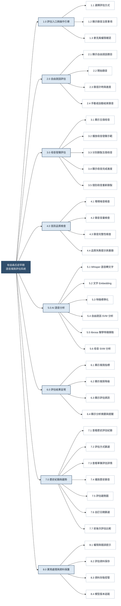
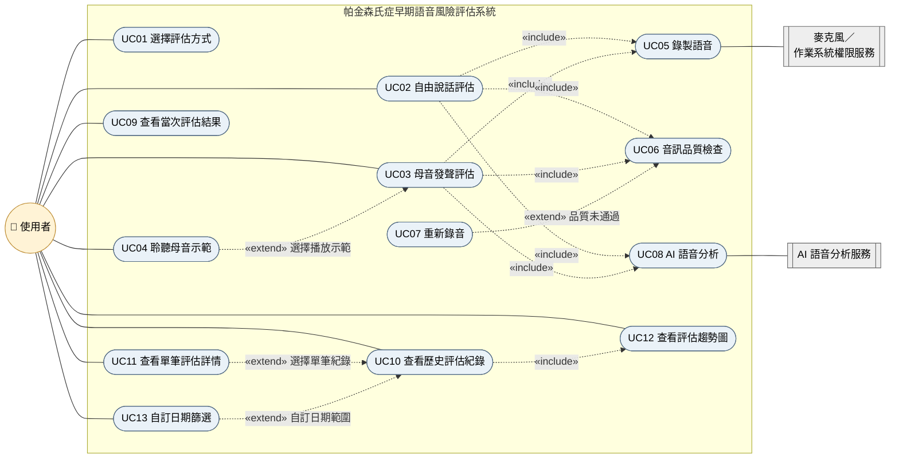

# 作業三：帕金森氏症早期語音風險評估系統

## 一、系統需求

### 一、功能性需求（Functional Requirements）

| 編號 | 需求名稱 | 需求描述 | 相關角色 |
|:---:|:---|:---|:---:|
| FR-01 | 評估模式選擇與操作引導 | 系統應提供「自由說話評估」與「母音發聲評估」兩種評估方式，並於評估開始前提供錄音注意事項、操作說明及相關示範，引導使用者完成評估。 | 使用者 |
| FR-02 | 自由說話錄音 | 系統應提供自由說話題目，讓使用者依照題目自然回答。錄音期間應顯示錄音時間、進度條及錄音狀態，錄音滿 10 秒後可手動結束，最長錄音時間為 25 秒。 | 使用者 |
| FR-03 | 母音發聲示範與錄音 | 系統應依序提供 A、E、I、O、U 五個母音的發聲示範及錄音功能。使用者可於同一頁面聆聽示範並進行錄音，每個母音應以一口氣持續發聲約 4～6 秒，完成五個母音後進入分析流程。 | 使用者 |
| FR-04 | 音訊品質檢查 | 系統應於語音分析前檢查錄音的環境噪音、錄音音量及錄音完整性。若音訊品質未達要求，應顯示未通過的原因，並提供重新錄音功能。 | 使用者 |
| FR-05 | 自由說話 AI 語音分析 | 系統應使用 Whisper 將自由說話音訊轉換為文字，透過文字 Embedding 模型將文字轉換為特徵向量，經過標準化處理後，輸入自由說話專用的 SVM 模型進行風險評估。 | AI 語音分析服務 |
| FR-06 | 母音發聲 AI 語音分析 | 系統應使用 librosa 擷取五個母音錄音中的聲學特徵，依照模型訓練時的特徵處理規則，將特徵輸入母音發聲專用的 SVM 模型，產生一次母音發聲評估結果。 | AI 語音分析服務 |
| FR-07 | 評估結果呈現 | 系統應顯示本次評估的語音風險指標、風險等級、評估日期、評估方式及分析摘要，並以不同顏色及文字呈現低風險、中度風險與較高風險。 | 使用者 |
| FR-08 | 歷史評估紀錄管理 | 系統應保存已完成的評估紀錄，包含評估日期、時間、評估方式及風險指標。使用者可依評估類型篩選紀錄，並查看單筆評估的詳細內容及仍可存取的錄音。 | 使用者 |
| FR-09 | 評估趨勢分析與日期篩選 | 系統應提供近一個月、近三個月、近六個月及近一年的風險指標趨勢圖，並支援自訂開始日期及結束日期。自由說話與母音發聲應分別呈現其歷史變化。 | 使用者 |
| FR-10 | 異常處理與操作回饋 | 當麥克風權限不足、錄音中斷、音訊品質不合格、網路連線失敗或 AI 分析異常時，系統應提供明確的錯誤提示及重新操作方式。 | 使用者、AI 語音分析服務 |

#### 功能需求補充說明

**1. 自由說話評估**

- 系統應提供自然說話的引導題目，例如「最近有沒有發生什麼讓你印象深刻的事情？」。
- 使用者應以平常聊天的方式自然回答，不需要朗讀固定文字。
- 系統應顯示即時錄音時間及錄音進度。
- 錄音滿 10 秒後，使用者可自行結束錄音。
- 錄音達 25 秒時，系統應自動停止錄音。
- 錄音完成後，系統應進行音訊品質檢查。

**2. 母音發聲評估**

- 系統應依序提供 A、E、I、O、U 五個母音的評估。
- 每個母音應提供對應的發聲示範音訊。
- 使用者可於同一頁面聆聽示範及進行錄音。
- 使用者應先吸一口氣，再以一口氣持續發出指定母音。
- 每個母音的發聲時間約為 4～6 秒。
- 系統應顯示目前的母音及整體完成進度。
- 若其中一個母音錄音品質不合格，應允許使用者重新錄製該母音。
- 五個母音皆完成且品質合格後，系統才進行母音 AI 分析。

**3. 音訊品質檢查**

- 環境噪音檢查：判斷錄音是否受到過多背景噪音干擾。
- 錄音音量檢查：判斷使用者的發聲音量是否符合分析需求。
- 錄音完整性檢查：判斷錄音時間及音訊內容是否符合評估要求。
- 品質未通過時，系統應提供改善建議及重新錄音功能。
- 實際品質判定門檻應依音訊處理及模型實驗結果訂定。

**4. 評估結果與風險分級**

目前系統介面原型規劃以下三種風險等級：

| 風險指標 | 風險等級 | 顯示顏色 |
|:---:|:---:|:---:|
| 0～40% | 低風險 | 綠色 |
| 41～70% | 中度風險 | 黃色 |
| 71～100% | 較高風險 | 紅色 |

- 系統應同時使用顏色及文字呈現風險等級。
- 自由說話與母音發聲使用不同的 AI 分析模型，分別產生評估結果。
- 評估結果應附上「此結果僅供評估參考，不作為臨床診斷依據」的提醒。
- 上述風險分級為目前原型的呈現規則，正式分級門檻仍須經過模型實驗及臨床驗證。
- 風險指標不等同於罹患帕金森氏症的機率。

**5. 歷史紀錄與趨勢分析**

- 系統應提供全部、自由說話及母音發聲三種紀錄篩選方式。
- 系統應提供近一個月、近三個月、近六個月及近一年的趨勢查詢。
- 使用者可透過日曆功能自訂查詢日期範圍。
- 自由說話與母音發聲應以不同資料系列呈現。
- 系統應提供相同評估方式且計分方法可比較的前後次結果比較。
- 若前次風險指標為 22%，本次為 28%，應顯示增加 6 個百分點。
- 若指定期間沒有評估資料，系統應顯示無紀錄提示，不得產生不存在的資料。

---

### 二、非功能性需求（Non-Functional Requirements）

以下驗收標準為系統預定達成的品質目標，實際成果須經後續測試確認。

| 編號 | 類別 | 需求描述 | 驗收標準 |
|:---:|:---:|:---|:---|
| NFR-01 | 易用性（Usability） | 考量主要使用者包含中高齡族群，系統應採用簡潔的操作介面、較大的文字、清楚的圖示及容易辨識的按鈕，避免過多專業術語與複雜操作。 | 主要說明文字原則上不小於 16 邏輯像素，主要操作按鈕的可點擊範圍至少為 48 × 48 邏輯像素；透過使用者測試確認長者能在有限協助下完成評估。 |
| NFR-02 | 效能（Performance） | 系統應具備良好的操作反應速度，並於音訊品質檢查及 AI 分析期間提供進度或處理狀態，避免使用者誤以為系統停止運作。 | 在指定測試裝置及穩定網路環境下，一般頁面應於 3 秒內載入，錄音操作應於 1 秒內提供狀態回饋；AI 分析逾時應提供提示。 |
| NFR-03 | 安全性與隱私（Security and Privacy） | 系統應保護使用者的錄音資料、評估結果及個人資訊，取得麥克風權限後才可錄音，並使用安全的資料傳輸方式。 | 未取得麥克風權限時不得錄音；對外資料傳輸應採用 HTTPS/TLS；未經授權者不得存取他人的錄音與評估資料。 |
| NFR-04 | 資料完整性（Data Integrity） | 系統應確保錄音檔案、評估方式、評估時間、模型版本及分析結果正確對應，避免資料遺失或錯誤配對。 | 每次評估均具有對應紀錄；五個母音錄音須與 A、E、I、O、U 正確對應；缺少必要錄音時不得產生完整評估結果。 |
| NFR-05 | 可靠性（Reliability） | 系統應具備錯誤處理及重新操作機制，當錄音、網路傳輸或 AI 分析發生異常時，應避免資料損毀及錯誤結果。 | 模擬錄音中斷、音量不足、網路斷線及模型服務失敗等情境，系統均應顯示適當提示，並提供可行的重試方式。 |
| NFR-06 | 可擴充性（Scalability） | 系統架構應能支援未來新增語音評估方式、更新 AI 模型及增加歷史評估資料，避免新增功能時需要重新設計整體系統。 | 新增或更新其中一種語音分析模型時，不應影響另一種評估流程；歷史紀錄應支援資料量增加後的分頁或漸進載入。 |
| NFR-07 | 可維護性（Maintainability） | 系統應將操作介面、錄音處理、音訊品質檢查、AI 模型分析及資料管理等功能適當分離，並透過 GitHub 進行版本管理。 | 程式碼應具有一致的命名規則及必要註解；功能修改應能透過 GitHub 版本紀錄追蹤，重要功能應具有基本測試。 |
| NFR-08 | 可理解性與風險溝通（Understandability） | 系統應以容易理解的文字呈現評估結果，明確區分語音風險指標與醫療診斷，避免使用者將評估結果誤認為確診結果。 | 所有評估結果頁面均應顯示非診斷提醒；透過使用者測試確認使用者能理解風險指標的基本意義。 |

---

## 二、功能分解圖

### 一、功能分解圖

---

### 二、功能分解說明

| 編號 | 功能模組 | 子功能 | 使用角色 |
|:---:|:---|:---|:---:|
| 1.0 | 評估入口與操作引導 | 評估方式選擇、錄音注意事項、麥克風權限確認 | 使用者 |
| 2.0 | 自由說話評估 | 題目顯示、開始錄音、錄音計時、手動及自動停止錄音 | 使用者 |
| 3.0 | 母音發聲評估 | 五個母音示範、獨立錄音、完成進度顯示、個別母音重錄 | 使用者 |
| 4.0 | 音訊品質檢查 | 環境噪音、錄音音量、錄音完整性檢查及重錄提示 | 使用者、系統 |
| 5.0 | AI 語音分析 | Whisper 語音轉文字、文字 Embedding、特徵標準化、librosa 聲學特徵擷取及兩種 SVM 模型分析 | AI 語音分析服務 |
| 6.0 | 評估結果呈現 | 風險指標、風險等級、評估資訊、分析摘要及非診斷提醒 | 使用者 |
| 7.0 | 歷史紀錄與趨勢 | 歷史紀錄、評估類型篩選、錄音播放、趨勢圖、日期篩選及前後次比較 | 使用者 |
| 8.0 | 異常處理與資料保護 | 權限確認、錯誤提示、資料保存、存取控管及模型版本追蹤 | 系統 |

---

## 三、使用案例圖與使用案例說明

### 一、參與者（Actors）

| 參與者 | 類型 | 說明 |
|:---|:---:|:---|
| 使用者 | 主要參與者 | 使用本系統進行自由說話評估、母音發聲評估、查看評估結果及歷史趨勢的一般民眾，主要考量中高齡族群的操作需求。 |
| 麥克風／作業系統權限服務 | 次要參與者（外部服務） | 提供裝置麥克風存取權限、音訊錄製及錄音狀態等功能。 |
| AI 語音分析服務 | 次要參與者（支援服務） | 負責執行 Whisper 語音轉文字、文字 Embedding、librosa 聲學特徵擷取及對應的 SVM 模型分析，並回傳評估結果。 |

---

### 二、使用案例圖（Use Case Diagram）

> **圖例說明：**
>
> - 實線：代表參與者與使用案例之間的關聯。
> - 虛線 `«include»`：代表完成主要使用案例時所包含的必要功能。
> - 虛線 `«extend»`：代表在特定條件下才會執行的延伸功能。
> - 系統邊界：代表本系統所包含的功能範圍。
> - 自由說話及母音發聲評估皆須在音訊品質通過後，才能執行 AI 語音分析。

---

### 三、使用案例說明

#### UC02 自由說話評估

| 項目 | 內容 |
|:---|:---|
| **使用案例編號** | UC02 |
| **使用案例名稱** | 自由說話評估 |
| **主要參與者** | 使用者 |
| **次要參與者** | 麥克風／作業系統權限服務、AI 語音分析服務 |
| **描述** | 使用者依照系統提供的題目進行自然說話，系統透過錄音品質檢查、語音轉文字、文字特徵擷取及 SVM 模型分析，產生本次語音風險評估結果。 |
| **前置條件** | 1. 使用者已開啟 App。 2. 裝置具有可正常使用的麥克風。 3. 使用者已允許麥克風存取權限。 |
| **後置條件** | 1. 系統完成自由說話音訊分析。 2. 系統顯示本次評估結果。 3. 系統保存本次評估紀錄，供使用者日後查閱。 |
| **包含（include）** | UC05 錄製語音、UC06 音訊品質檢查、UC08 AI 語音分析 |

**主要流程**

1. 使用者開啟 App，進入首頁。
2. 使用者選擇「自由說話評估」。
3. 系統顯示錄音注意事項，包含保持安靜環境、手機與嘴巴保持約 15 公分距離及自然說話。
4. 使用者確認注意事項後，點選「我準備好了」。
5. 系統進入自由說話錄音頁面。
6. 系統顯示本次自由說話題目，例如「最近有沒有發生什麼讓你印象深刻的事情？」。
7. 使用者點選「開始錄音」。
8. 系統開始錄音，並顯示錄音時間及錄音進度。
9. 使用者依照題目，以平常聊天的方式自然回答。
10. 錄音滿 10 秒後，系統允許使用者手動結束錄音。
11. 使用者點選「結束錄音」。
12. 系統進入音訊品質檢查頁面。
13. 系統依序檢查環境噪音、錄音音量及錄音完整性。
14. 音訊品質檢查通過後，系統進入 AI 語音分析流程。
15. 系統使用 Whisper 將錄音轉換為文字。
16. 系統透過文字 Embedding 模型將文字轉換為特徵向量。
17. 系統依照模型訓練規格進行特徵標準化。
18. 系統將處理後的特徵向量輸入自由說話專用 SVM 模型。
19. 系統取得本次語音風險指標。
20. 系統顯示評估結果、風險等級及相關提醒。
21. 系統保存本次評估紀錄。

**替代流程**

- **10a. 使用者在錄音未滿 10 秒時想結束錄音：**
  1. 系統提示尚未達到最低錄音時間。
  2. 使用者繼續進行錄音。
  3. 錄音滿 10 秒後即可手動結束。

- **11a. 使用者未手動結束錄音：**
  1. 錄音持續進行至 25 秒。
  2. 系統自動停止錄音。
  3. 系統進入音訊品質檢查流程。

- **13a. 音訊品質檢查未通過：**
  1. 系統顯示未通過的項目及原因。
  2. 系統提供重新錄音建議。
  3. 使用者點選「重新錄音」。
  4. 系統返回自由說話錄音頁面。

**例外流程**

- **7a. 使用者未授予麥克風權限：** 系統提示使用者開啟麥克風權限，並暫停錄音流程。
- **8a. 錄音期間發生中斷：** 系統提示錄音未完成，並提供重新錄音功能。
- **14a. 網路連線失敗：** 系統顯示連線異常提示，並提供重試功能。
- **18a. AI 模型分析失敗：** 系統顯示分析失敗訊息，不產生不正確的評估結果。

**業務規則**

- 自由說話錄音至少滿 10 秒後才可手動結束。
- 自由說話錄音最長為 25 秒。
- 錄音內容應為使用者自然說話的內容，不限制標準答案。
- 音訊品質檢查通過後，才可進行 AI 語音分析。
- 自由說話評估應使用自由說話專用的 SVM 模型。

---

#### UC03 母音發聲評估

| 項目 | 內容 |
|:---|:---|
| **使用案例編號** | UC03 |
| **使用案例名稱** | 母音發聲評估 |
| **主要參與者** | 使用者 |
| **次要參與者** | 麥克風／作業系統權限服務、AI 語音分析服務 |
| **描述** | 使用者依序完成 A、E、I、O、U 五個母音的持續發聲錄音。系統透過 librosa 擷取聲學特徵，並使用母音專用 SVM 模型進行分析，產生本次母音發聲評估結果。 |
| **前置條件** | 1. 使用者已進入母音發聲評估功能。 2. 裝置麥克風可正常使用。 3. 使用者已允許麥克風存取權限。 |
| **後置條件** | 1. 系統取得五個品質合格的母音錄音。 2. 系統完成聲學特徵擷取及 AI 模型分析。 3. 系統產生並保存一次母音發聲評估結果。 |
| **包含（include）** | UC05 錄製語音、UC06 音訊品質檢查、UC08 AI 語音分析 |
| **延伸（extend）** | UC04 聆聽母音示範、UC07 重新錄音 |

**主要流程**

1. 使用者開啟 App，進入首頁。
2. 使用者選擇「母音發聲評估」。
3. 系統顯示母音發聲注意事項。
4. 系統進入母音評估頁面，顯示 A、E、I、O、U 五個母音及目前完成進度。
5. 系統顯示第一個母音 A 的發聲方式。
6. 使用者可點選播放按鈕，聆聽 A 母音的發聲示範。
7. 使用者確認發聲方式後，先吸一口氣。
8. 使用者點選「開始錄音」。
9. 系統開始錄音並顯示錄音進度。
10. 使用者以一口氣持續發出指定母音約 4～6 秒。
11. 使用者完成該母音的錄音。
12. 系統檢查目前母音的錄音品質。
13. 錄音品質通過後，系統保存該母音音訊，並標示為已完成。
14. 使用者點選「下一個母音」。
15. 系統切換至下一個母音的發聲示範及錄音畫面。
16. 使用者依序完成 E、I、O、U 四個母音的錄音。
17. 系統確認五個母音皆已完成，且錄音品質符合要求。
18. 系統進入 AI 語音分析流程。
19. 系統使用 librosa 擷取五個母音錄音中的聲學特徵。
20. 系統依照母音模型的訓練規格進行特徵前處理。
21. 系統將處理後的聲學特徵輸入母音專用 SVM 模型。
22. 系統產生本次母音發聲風險指標。
23. 系統顯示本次評估結果及風險等級。
24. 系統保存本次母音發聲評估紀錄。

**替代流程**

- **6a. 使用者尚未理解母音發聲方式：**
  1. 使用者可再次播放發聲示範。
  2. 系統重新播放目前母音的示範音訊。
  3. 使用者確認後再開始錄音。

- **6b. 使用者已熟悉母音發聲方式：**
  1. 使用者可略過發聲示範。
  2. 直接進行目前母音的錄音。

- **12a. 母音發聲時間不足：**
  1. 系統提示發聲時間不足。
  2. 系統提供重新錄音功能。
  3. 使用者重新錄製目前母音。

- **12b. 母音錄音品質不合格：**
  1. 系統顯示音訊品質未通過的原因。
  2. 使用者重新錄製目前母音。
  3. 其他已完成的母音錄音不受影響。

**例外流程**

- **8a. 示範音訊仍在播放：** 系統應先停止示範音訊，再開始錄音，避免示範音訊干擾評估。
- **8b. 麥克風權限未開啟：** 系統顯示權限提示，暫停錄音。
- **17a. 五個母音尚未全部完成：** 系統提示尚未完成的母音，不進行完整母音評估。
- **21a. AI 模型分析失敗：** 系統顯示分析異常訊息，並提供重新分析或重試功能。

**業務規則**

- 母音評估順序為 A → E → I → O → U。
- 每個母音皆須獨立錄製一段音訊。
- 每個母音的目標發聲時間約為 4～6 秒。
- 使用者應以一口氣持續發出指定母音。
- 母音示範與錄音功能應整合於同一頁面。
- 五個母音全部完成且品質合格後，才可進行完整分析。
- 五個母音共同產生一次母音發聲評估結果，而非五個獨立的最終評估結果。

---

#### UC09 查看當次評估結果

| 項目 | 內容 |
|:---|:---|
| **使用案例編號** | UC09 |
| **使用案例名稱** | 查看當次評估結果 |
| **主要參與者** | 使用者 |
| **描述** | 使用者完成自由說話或母音發聲評估後，查看本次語音風險指標、風險等級、評估日期、評估方式及分析摘要。 |
| **前置條件** | 1. 使用者已完成語音錄音。 2. 音訊品質檢查已通過。 3. AI 語音分析已成功完成。 |
| **後置條件** | 1. 使用者取得本次評估結果。 2. 系統保存本次評估紀錄。 3. 使用者可前往歷史評估紀錄頁面。 |

**主要流程**

1. 使用者完成自由說話或母音發聲錄音。
2. 系統執行音訊品質檢查。
3. 音訊品質通過後，系統執行對應的 AI 語音分析。
4. 系統顯示目前分析進度。
5. AI 模型完成分析後，系統進入「本次評估結果」頁面。
6. 系統顯示本次語音風險指標，例如 28%。
7. 系統依照風險分級規則顯示對應的風險等級。
8. 系統透過顏色及風險刻度條輔助呈現評估結果。
9. 系統顯示評估日期、評估方式及語音分析摘要。
10. 系統顯示「此結果僅供評估參考，不作為臨床診斷依據」。
11. 系統保存本次評估紀錄。
12. 使用者點選「查看評估紀錄」，進入歷史紀錄頁面。

**替代流程**

- **12a. 使用者暫時不查看歷史紀錄：** 使用者可透過底部導覽列返回首頁。
- **5a. AI 分析尚未完成：** 系統持續顯示分析狀態，直到分析完成或發生異常。

**例外流程**

- **3a. 音訊品質檢查未通過：** 系統不進行 AI 分析，並提示使用者重新錄音。
- **5b. AI 分析失敗：** 系統顯示分析失敗提示，不產生不正確的風險指標。
- **11a. 評估紀錄保存失敗：** 系統提示紀錄保存異常，並提供適當的重試方式。

**業務規則**

- 目前原型風險指標分為低風險、中度風險及較高風險。
- 風險等級應同時使用文字及顏色呈現。
- 評估結果應明確標示評估方式。
- 評估結果不得直接作為帕金森氏症的臨床診斷。
- 正式風險分級門檻須經過模型實驗及臨床驗證。

---

#### UC10 查看歷史評估紀錄與趨勢

| 項目 | 內容 |
|:---|:---|
| **使用案例編號** | UC10 |
| **使用案例名稱** | 查看歷史評估紀錄與趨勢 |
| **主要參與者** | 使用者 |
| **描述** | 使用者透過歷史評估紀錄頁面查看過去的評估結果，並透過不同時間範圍的趨勢圖觀察語音風險指標變化。 |
| **前置條件** | 系統可取得使用者有權存取的歷史評估資料。 |
| **後置條件** | 系統顯示符合查詢條件的歷史評估紀錄及趨勢圖，不修改原始評估資料。 |
| **包含（include）** | UC12 查看評估趨勢圖 |
| **延伸（extend）** | UC11 查看單筆評估詳情、UC13 自訂日期篩選 |

**主要流程**

1. 使用者點選底部導覽列的「紀錄」。
2. 系統進入評估紀錄頁面。
3. 系統載入使用者過去的評估資料。
4. 系統依照評估日期排列歷史紀錄。
5. 系統顯示每筆紀錄的評估方式、評估日期、評估時間、風險指標及風險等級。
6. 系統顯示語音風險指標趨勢圖。
7. 使用者選擇「全部」、「自由說話」或「母音發聲」。
8. 系統依照選擇的評估方式更新紀錄及趨勢圖。
9. 使用者選擇近一個月、近三個月、近六個月或近一年。
10. 系統依照所選時間範圍更新趨勢圖。
11. 系統以不同資料系列呈現自由說話與母音發聲的歷史風險指標。
12. 使用者點選其中一筆評估紀錄。
13. 系統進入評估紀錄詳情頁面。
14. 系統顯示該次評估的風險指標、評估日期、評估時間及評估方式。
15. 若存在可比較的同類型前次評估結果，系統顯示前後次指標差異。
16. 若該次錄音仍可存取，使用者可播放錄音。

**替代流程**

- **7a. 使用者只想查看自由說話評估：**
  1. 使用者選擇「自由說話」。
  2. 系統只顯示自由說話評估紀錄及對應趨勢。

- **7b. 使用者只想查看母音發聲評估：**
  1. 使用者選擇「母音發聲」。
  2. 系統只顯示母音發聲評估紀錄及對應趨勢。

- **10a. 所選期間沒有評估紀錄：**
  1. 系統顯示「此期間尚無評估紀錄」。
  2. 系統不顯示不存在的風險指標資料。

- **11a. 某一種評估方式只有一筆紀錄：**
  1. 系統僅顯示該筆資料點。
  2. 系統不繪製不存在的歷史趨勢線。

- **15a. 沒有相同評估方式的前次紀錄：** 系統顯示目前沒有可供比較的前次評估資料。

**例外流程**

- **3a. 歷史紀錄載入失敗：** 系統顯示資料載入異常，並提供重新載入功能。
- **16a. 錄音檔案已不存在或無存取權限：** 系統提示無法播放錄音，其他可存取的評估資訊仍可正常顯示。

**業務規則**

- 歷史評估紀錄應依日期及時間排序。
- 自由說話與母音發聲應使用不同資料系列呈現。
- 趨勢圖不得將不同評估方式的風險指標直接連接成同一條折線。
- 前後次評估比較應使用相同評估方式及可比較的模型計分規格。
- 風險指標差異應以百分點表示。
- 歷史風險指標變化不應直接解讀為疾病改善或惡化。

---

#### UC13 自訂日期篩選

| 項目 | 內容 |
|:---|:---|
| **使用案例編號** | UC13 |
| **使用案例名稱** | 自訂日期篩選 |
| **主要參與者** | 使用者 |
| **描述** | 使用者透過評估紀錄頁面右上方的日曆功能，自訂開始日期及結束日期，查詢指定時間範圍內的評估紀錄及趨勢。 |
| **前置條件** | 使用者已進入評估紀錄頁面。 |
| **後置條件** | 系統依照指定日期範圍更新評估紀錄及趨勢圖；若取消操作，則維持原本的篩選條件。 |
| **延伸（extend）** | 從 UC10 查看歷史評估紀錄延伸而來。 |

**主要流程**

1. 使用者進入評估紀錄頁面。
2. 使用者點選右上方的日曆圖示。
3. 系統顯示「選擇紀錄日期」視窗。
4. 系統提供「查看全部紀錄」及「自訂日期範圍」兩種選項。
5. 使用者選擇「自訂日期範圍」。
6. 使用者選擇開始日期。
7. 使用者選擇結束日期。
8. 使用者點選「套用篩選」。
9. 系統檢查日期範圍是否有效。
10. 日期範圍有效時，系統關閉日期選擇視窗。
11. 系統依照指定日期範圍更新評估紀錄。
12. 系統同步更新語音風險指標趨勢圖。

**替代流程**

- **5a. 使用者選擇查看全部紀錄：**
  1. 系統清除原本的日期篩選條件。
  2. 系統顯示全部可存取的歷史評估紀錄。

- **8a. 使用者點選取消：**
  1. 系統關閉日期選擇視窗。
  2. 系統保留原本的日期篩選條件。

- **11a. 指定日期範圍內沒有評估紀錄：** 系統顯示無評估紀錄提示。

**例外流程**

- **9a. 結束日期早於開始日期：**
  1. 系統顯示日期範圍錯誤提示。
  2. 系統不套用篩選條件。
  3. 使用者重新選擇正確的日期範圍。

- **9b. 使用者未完成日期選擇：** 系統提示使用者完成開始日期及結束日期的設定。

**業務規則**

- 結束日期不得早於開始日期。
- 日期篩選應同步影響歷史紀錄列表及趨勢圖。
- 取消日期篩選時不得修改原本的查詢條件。
- 日期與時間應以一致的格式呈現。

---

## 四、需求與使用案例追蹤表

| 功能性需求 | 對應使用案例 | 驗證重點 |
|:---:|:---|:---|
| FR-01 | UC01、UC02、UC03 | 評估模式選擇及操作引導是否正確。 |
| FR-02 | UC02、UC05 | 自由說話錄音時間、進度及停止錄音功能是否正確。 |
| FR-03 | UC03、UC04、UC05 | 五個母音示範、錄音順序及完成進度是否正確。 |
| FR-04 | UC06、UC07 | 音訊品質檢查及重新錄音功能是否正常。 |
| FR-05 | UC02、UC08 | 自由說話是否使用 Whisper、文字 Embedding、標準化及對應 SVM 模型。 |
| FR-06 | UC03、UC08 | 五個母音是否經過 librosa 聲學特徵擷取及母音 SVM 模型分析。 |
| FR-07 | UC09 | 評估結果、風險指標、風險等級及相關提醒是否正確呈現。 |
| FR-08 | UC10、UC11 | 歷史紀錄、評估資訊及錄音播放功能是否正常。 |
| FR-09 | UC12、UC13 | 趨勢圖、時間範圍切換及日期篩選是否正確。 |
| FR-10 | UC02、UC03、UC06、UC08 | 錄音異常、權限不足及分析失敗時是否具有適當的錯誤處理。 |

---

## 五、確認（Validation）與驗證（Verification）

### 一、確認（Validation）

- **目的：** 確保本系統符合目標使用者及利害關係人的實際需求。
- **關注重點：** 系統是否具備實際使用價值，以及操作方式是否符合中高齡使用者的需求。
- **核心問題：** 我們是否在做正確的事？

**本專題的確認方式：**

1. 與指導老師及醫療合作人員討論語音評估流程，確認自由說話及母音發聲任務的適用性。
2. 透過介面原型確認中高齡使用者是否能理解錄音注意事項及操作方式。
3. 確認文字大小、按鈕大小及圖示是否符合長者的閱讀與操作需求。
4. 確認使用者是否能理解評估結果及風險指標所代表的意義。
5. 確認歷史紀錄與趨勢圖是否有助於使用者觀察長期評估變化。

**實際設計案例：**

原先母音發聲示範與母音錄音分別設計為兩個頁面，經過與指導老師討論後，將兩項功能整合至同一頁面，使使用者能夠先聆聽示範，再直接進行錄音，減少長者在不同頁面之間切換的操作負擔。

此項調整屬於確認（Validation），因為主要目的是確認系統設計是否符合目標使用者的實際需求。

---

### 二、驗證（Verification）

- **目的：** 確保系統依照已訂定的功能性需求及非功能性需求正確開發。
- **關注重點：** 系統功能、程式邏輯、資料處理及操作流程是否符合規格。
- **核心問題：** 我們是否正確地做事？

**本專題的驗證方式：**

1. 測試自由說話錄音是否於滿 10 秒後允許手動結束，並於 25 秒時自動停止。
2. 測試母音發聲評估是否依照 A、E、I、O、U 的順序進行。
3. 測試五個母音錄音是否正確保存並對應其母音名稱。
4. 測試音訊品質未通過時，系統是否阻止 AI 分析並提供重新錄音功能。
5. 測試自由說話及母音發聲是否使用各自對應的 AI 分析模型。
6. 測試評估結果及歷史紀錄是否正確保存。
7. 測試歷史趨勢圖是否正確呈現不同評估方式的資料。
8. 測試自訂日期篩選是否正確更新評估紀錄及趨勢圖。
9. 測試麥克風權限不足、網路連線失敗及 AI 分析異常時的錯誤處理。

**實際測試案例：**

當使用者進行自由說話評估時，若錄音時間達到 25 秒，系統應自動停止錄音並進入音訊品質檢查頁面。透過實際操作測試確認系統是否符合此項需求，即屬於驗證（Verification）。

---

### 三、確認與驗證的差異

| 比較項目 | 確認（Validation） | 驗證（Verification） |
|:---:|:---|:---|
| 核心問題 | 我們是否在做正確的事？ | 我們是否正確地做事？ |
| 主要目的 | 確保系統符合使用者需求 | 確保系統符合設計規格 |
| 關注重點 | 產品價值、使用體驗及實際需求 | 功能正確性、程式邏輯及系統品質 |
| 執行方式 | 使用者訪談、原型測試、醫療合作人員及指導老師討論 | 功能測試、整合測試、程式碼審查 |
| 本專題案例 | 將母音示範與錄音整合於同一頁面，降低長者操作負擔 | 測試五個母音是否依序錄製，並確認錄音資料正確保存 |
| 預期成果 | 建立符合目標使用者需求的系統 | 建立符合需求規格且功能正確的系統 |

---

## 六、總結

本專題以帕金森氏症早期語音風險評估為主要目標，透過自由說話及母音發聲兩種不同的語音評估方式，蒐集使用者的語音資料，並使用人工智慧模型進行分析。

自由說話評估透過 Whisper 將語音轉換為文字，再使用文字 Embedding 擷取文字特徵，經過標準化後輸入 SVM 模型進行分析；母音發聲評估則透過 librosa 擷取聲學特徵，並使用另一個 SVM 模型進行分析。兩種評估方式具有各自獨立的分析流程及評估結果。

除了 AI 語音分析之外，系統亦提供音訊品質檢查、長者友善操作介面、評估結果視覺化、歷史評估紀錄及長期趨勢分析等功能，使使用者能夠在日常生活中進行語音評估，並持續觀察自身語音風險指標的變化。

透過本次系統需求分析、功能分解圖及使用案例的建立，可以更加明確地定義系統的功能範圍、操作流程及品質要求，並作為後續系統開發、測試與維護的依據。

本系統定位為早期語音風險評估及長期追蹤的輔助工具，評估結果僅供參考，不能取代專業醫師的臨床診斷。
