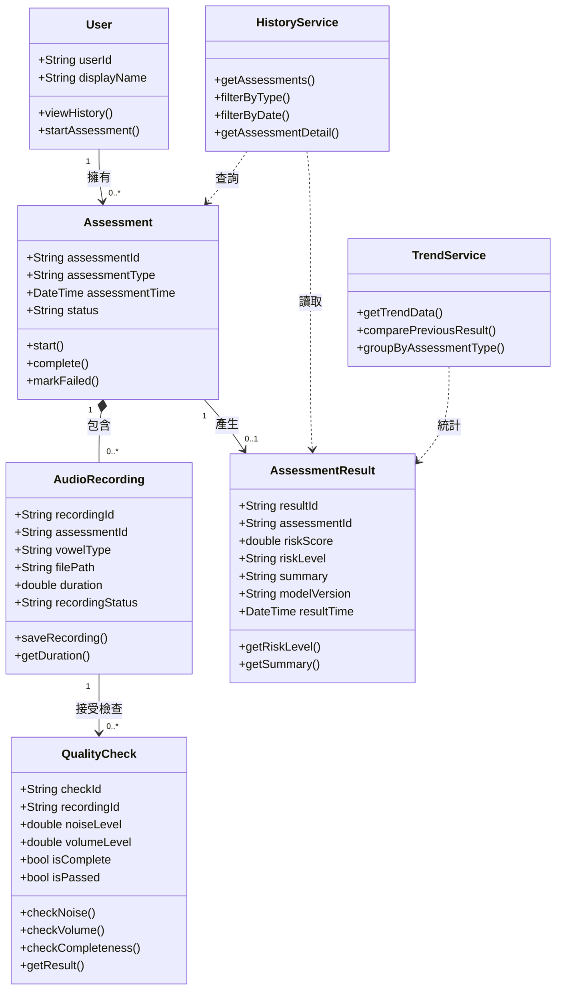
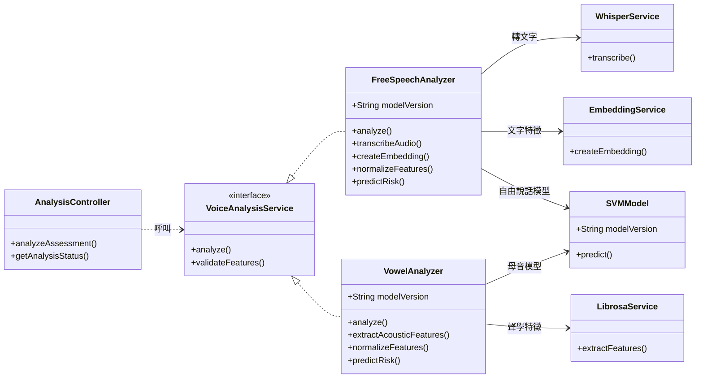
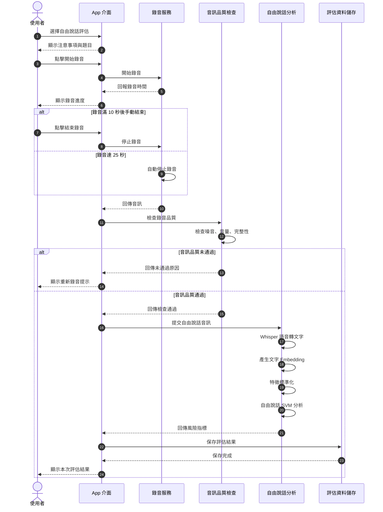
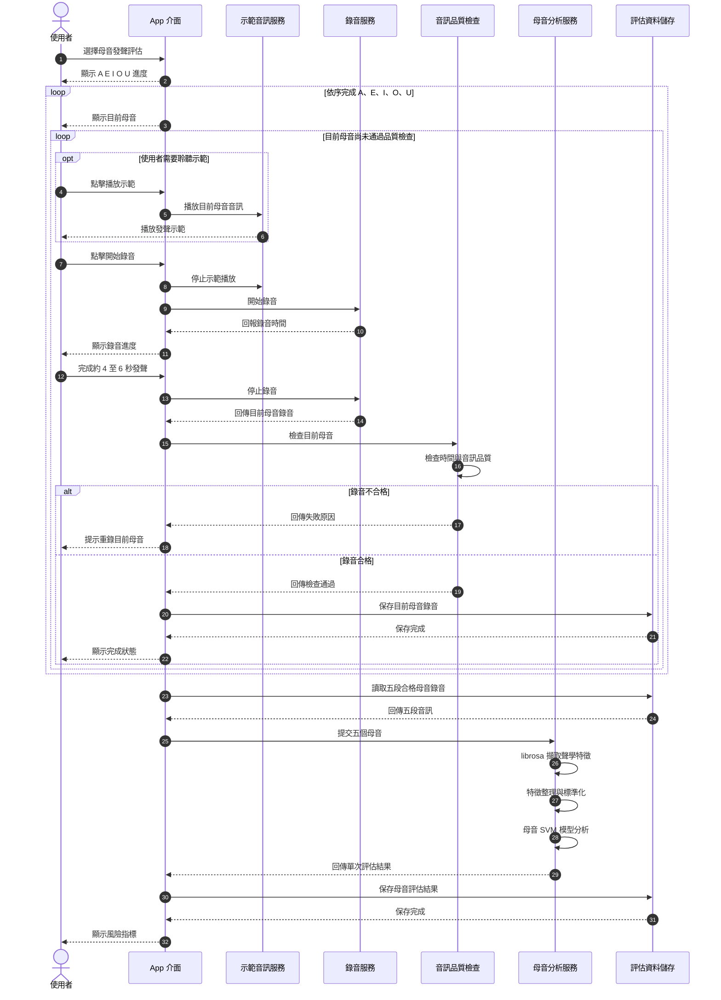
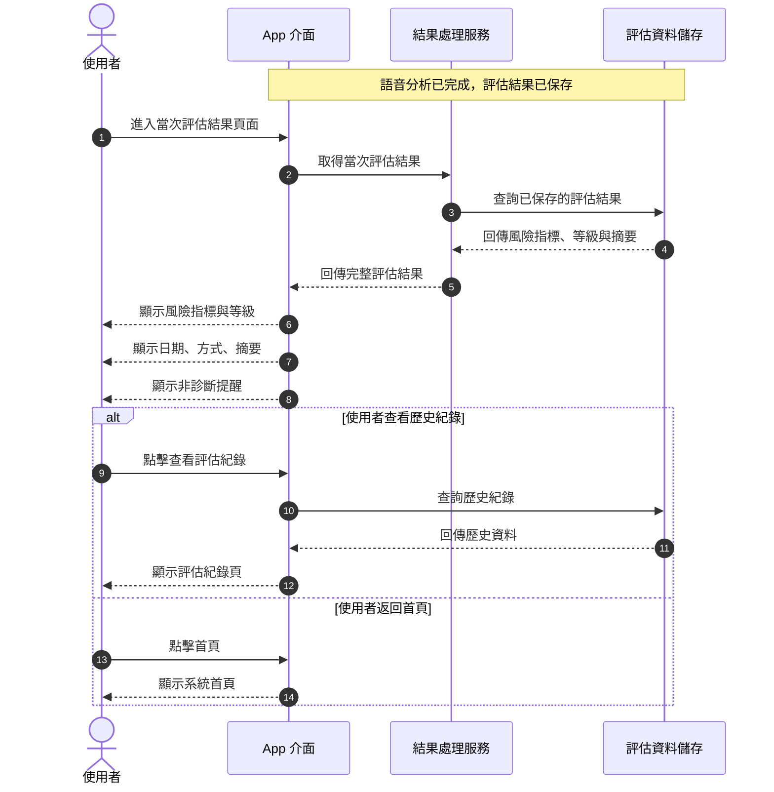
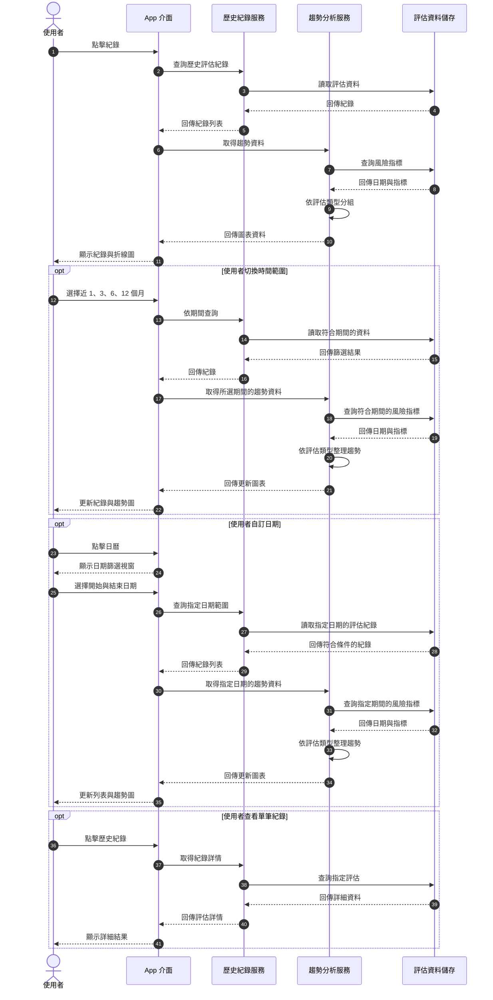
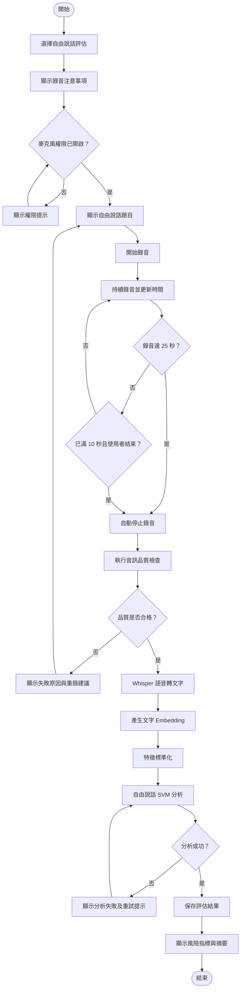
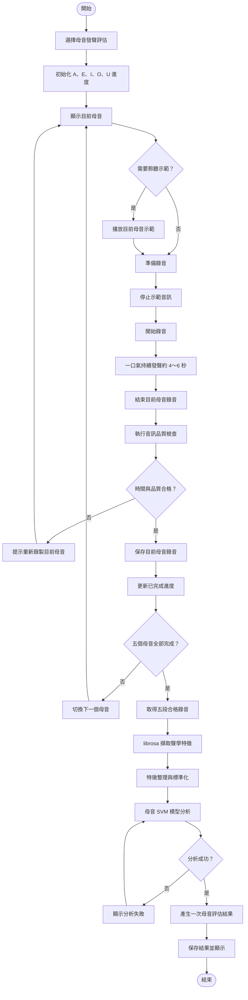
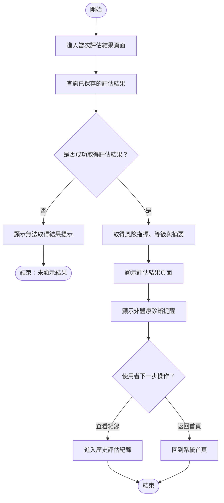
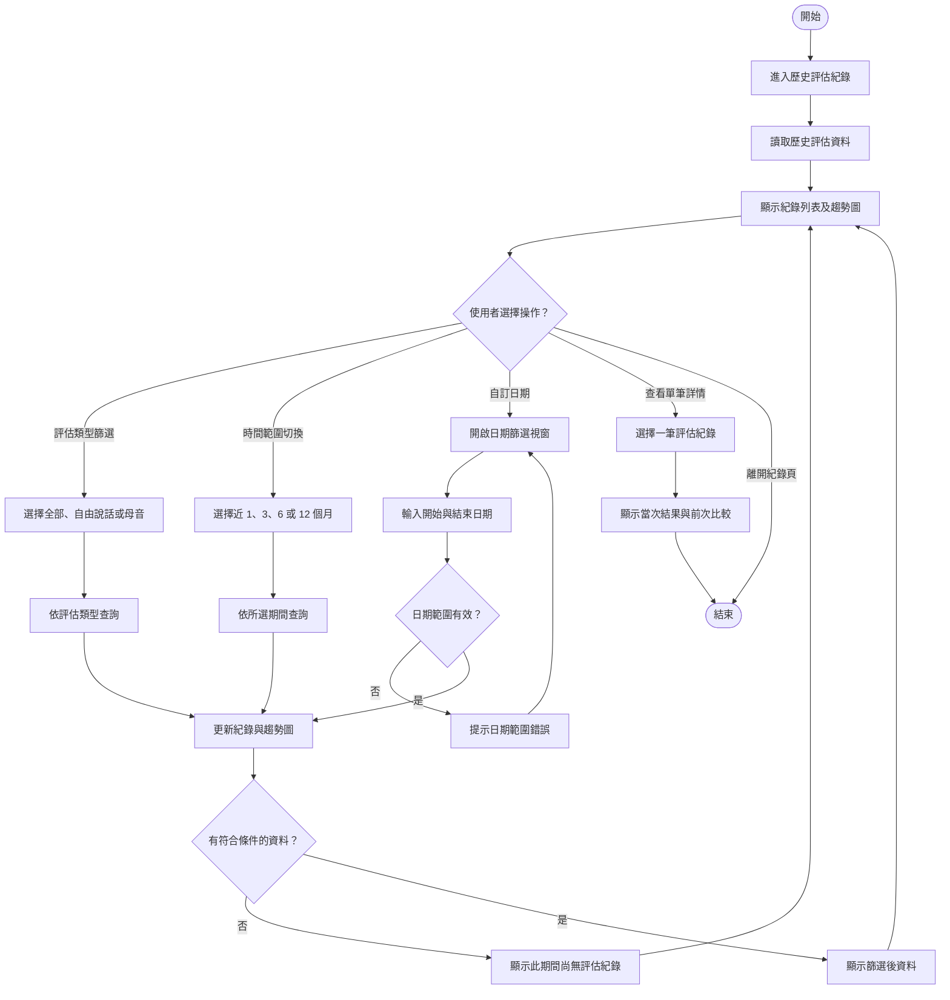

# 作業四：帕金森氏症早期語音風險評估系統

## 一、UML 類別圖（Class Diagram）

### 1.1 系統類別圖說明

本系統主要透過自由說話與母音發聲兩種評估方式，蒐集使用者的語音資料，經過音訊品質檢查及人工智慧模型分析後，產生語音風險指標，並提供歷史紀錄及趨勢查詢功能。

為了讓各項功能容易維護與擴充，本系統的類別設計分為四個部分：

1. **評估資料管理**：管理使用者、評估紀錄、錄音資料及評估結果。
2. **音訊處理**：負責錄音控制、音訊品質檢查及重新錄音。
3. **AI 語音分析**：分別處理自由說話及母音發聲的特徵擷取與 SVM 模型分析。
4. **歷史資料查詢**：負責歷史紀錄、日期篩選及風險指標趨勢圖。

本類別圖為依據系統需求規劃的設計模型，並非直接從既有程式碼反向產生。

### 1.2 核心資料類別圖

### 1.3 核心資料類別說明

| 類別名稱 | 主要屬性 | 主要方法 | 功能說明 |
|:---|:---|:---|:---|
| User | userId、displayName | startAssessment、viewHistory | 代表使用者及其評估操作。 |
| Assessment | assessmentId、assessmentType、assessmentTime、status | start、complete、markFailed | 管理一次語音評估的基本資訊及狀態。 |
| AudioRecording | recordingId、assessmentId、vowelType、filePath、duration | saveRecording、getDuration | 保存自由說話或個別母音的錄音資訊。 |
| QualityCheck | checkId、noiseLevel、volumeLevel、isComplete、isPassed | checkNoise、checkVolume、checkCompleteness | 記錄音訊品質檢查的結果。 |
| AssessmentResult | resultId、riskScore、riskLevel、summary、modelVersion | getRiskLevel、getSummary | 保存一次評估產生的模型風險指標及相關資訊。 |
| HistoryService | 無固定資料屬性 | getAssessments、filterByType、filterByDate | 提供歷史紀錄查詢及篩選。 |
| TrendService | 無固定資料屬性 | getTrendData、comparePreviousResult | 提供歷史風險指標趨勢及前後次比較。 |

### 1.4 類別之間的關係

**1. User 與 Assessment**

一位使用者可以進行多次評估，因此 User 與 Assessment 為一對多關係。

**2. Assessment 與 AudioRecording**

一次自由說話評估通常包含一段有效錄音；一次母音發聲評估則需要 A、E、I、O、U 五段有效錄音。

每段錄音都有對應的識別碼、時長及評估編號。

**3. AudioRecording 與 QualityCheck**

每段錄音都需要進行音訊品質檢查。

若錄音品質不合格，系統應提示使用者重新錄音；重新檢查時，可以產生新的檢查紀錄。

**4. Assessment 與 AssessmentResult**

一次成功完成的評估產生一筆最終結果。

尚未完成或分析失敗的評估可能沒有結果，因此使用零或一筆結果的關係。

**5. HistoryService 與 TrendService**

HistoryService 提供歷史評估紀錄，TrendService 則使用評估結果資料計算歷史趨勢。

兩者分別負責資料查詢及統計呈現。

---

### 1.5 AI 語音分析服務類別圖

自由說話與母音發聲使用不同的特徵及分析流程，因此以共同的分析介面加上兩種分析服務表示。

### 1.6 AI 分析類別說明

| 類別名稱 | 功能說明 |
|:---|:---|
| VoiceAnalysisService | 定義不同評估方式共同使用的分析介面。 |
| FreeSpeechAnalyzer | 執行自由說話的語音轉文字、文字特徵處理及 SVM 分析。 |
| VowelAnalyzer | 執行五個母音的聲學特徵擷取及 SVM 分析。 |
| WhisperService | 將自由說話錄音轉換成文字。 |
| EmbeddingService | 將文字轉換成可供模型分析的特徵向量。 |
| LibrosaService | 擷取母音錄音的聲學特徵。 |
| SVMModel | 代表 SVM 預測功能；兩種評估方式使用各自訓練的模型。 |
| AnalysisController | 根據評估類型呼叫對應分析服務，並管理分析狀態。 |

### 1.7 AI 分析設計說明

#### 自由說話分析

自由說話採用以下流程：

1. 取得自由說話錄音。
2. 使用 Whisper 將語音轉換為文字。
3. 使用文字 Embedding 模型產生特徵向量。
4. 依照模型訓練時的規格進行標準化。
5. 使用自由說話專用 SVM 模型進行分析。
6. 將分析輸出轉換為系統定義的風險指標。
7. 保存分析結果。

#### 母音發聲分析

母音發聲採用以下流程：

1. 取得 A、E、I、O、U 五段合格錄音。
2. 使用 librosa 擷取各段錄音的聲學特徵。
3. 依照模型訓練時的規格進行特徵整理與標準化。
4. 將整理後的特徵輸入母音專用 SVM 模型。
5. 產生一次母音發聲評估的風險指標。
6. 保存分析結果。

#### 設計原則

- 自由說話與母音發聲使用不同的 SVM 模型。
- 五個母音共同產生一次母音發聲評估結果。
- 模型輸出必須依實際計分方式轉換為風險指標。
- 不可將風險指標直接解讀成罹患帕金森氏症的機率。
- 應保存模型版本，以利後續分析結果比較。

---

## 二、循序圖（Sequence Diagram）

循序圖用來表示使用者與系統之間的互動順序，描述在特定使用情境中，各個元件如何傳遞訊息並完成任務。

本作業選擇四個使用案例進行設計：

- UC02：自由說話評估
- UC03：母音發聲評估
- UC09：查看當次評估結果
- UC10：查看歷史評估紀錄與趨勢

### 2.1 UC02 自由說話評估循序圖

#### 流程說明

1. 使用者選擇自由說話評估。
2. 系統顯示錄音注意事項及題目。
3. 使用者開始錄音，系統持續顯示錄音進度。
4. 錄音滿 10 秒後可以手動結束，最長 25 秒。
5. 系統對音訊執行品質檢查。
6. 品質未通過時，系統提示重新錄音。
7. 品質通過時，系統執行 Whisper、Embedding、標準化及 SVM 分析。
8. 系統保存並顯示評估結果。

---

### 2.2 UC03 母音發聲評估循序圖

#### 流程說明

1. 使用者進入母音發聲評估頁面。
2. 系統依序顯示 A、E、I、O、U 五個母音。
3. 使用者可聆聽目前母音的示範音訊。
4. 使用者在同一頁面開始錄音。
5. 系統停止示範音訊，避免影響正式錄音。
6. 使用者使用一口氣發聲約 4～6 秒。
7. 系統檢查目前母音的時間及錄音品質。
8. 若品質不合格，使用者重新錄製目前母音，直到通過品質檢查。
9. 若品質合格，系統保存錄音並進入下一個母音。
10. 五個母音完成後，系統使用 librosa 擷取聲學特徵。
11. 系統使用母音專用 SVM 模型進行分析。
12. 系統產生並保存一次母音發聲評估結果。

---

### 2.3 UC09 查看當次評估結果循序圖

#### 流程說明

1. 自由說話或母音發聲評估完成後，系統已將分析結果保存。
2. 使用者進入當次評估結果頁面。
3. 結果處理服務查詢已保存的評估資料。
4. 系統取得風險指標、風險等級及分析摘要。
5. 系統顯示本次評估的日期、方式、風險指標及摘要。
6. 使用者可以進入歷史紀錄頁，或返回首頁。

本使用案例主要負責顯示當次評估結果，不會重複建立或保存評估資料。

#### 風險指標注意事項

目前原型介面使用低風險、中度風險與較高風險三種分類。

這些分類是介面展示規則，尚不代表通過臨床驗證的診斷門檻。

系統應明確說明評估結果僅供參考，不能取代醫療診斷。

---

### 2.4 UC10 查看歷史紀錄與趨勢循序圖

#### 流程說明

1. 使用者進入評估紀錄頁面。
2. 系統讀取使用者有權查看的歷史紀錄。
3. 系統依評估方式整理歷史風險指標。
4. 系統顯示自由說話及母音發聲的不同資料系列。
5. 使用者可以切換近一個月、近三個月、近六個月及近一年。
6. 使用者可以透過日曆自訂日期範圍。
7. 系統根據所選日期重新查詢歷史紀錄及趨勢資料。
8. 系統更新符合篩選條件的紀錄與趨勢圖。
9. 使用者可以進入單筆紀錄詳細頁面。

---

## 三、活動圖（Activity Diagram）

活動圖用來描述特定使用案例中的操作步驟、判斷條件及不同情況下的處理方式。

以下活動圖與循序圖對應同樣的四個使用案例。

### 3.1 UC02 自由說話評估活動圖

#### 活動圖說明

本流程主要包含三項判斷：

1. 麥克風權限是否正常。
2. 錄音時間與音訊品質是否符合規格。
3. AI 模型分析是否成功。

若錄音品質不合格，使用者需重新錄音；若分析失敗，系統應提供重試方式，不應產生虛構的評估結果。

---

### 3.2 UC03 母音發聲評估活動圖

#### 活動圖說明

母音發聲評估採用循環式操作。

使用者完成一個母音後，系統檢查該母音的錄音品質。

若品質不合格，只需重新錄製目前母音。

若品質合格，系統保存音訊並更新完成進度，接著進入下一個母音。

五個母音全部完成後，系統才進行完整的母音聲學特徵分析，並產生一次評估結果。

---

### 3.3 UC09 查看當次評估結果活動圖

#### 活動圖說明

系統應先確認當次評估已完成，且有成功保存的評估結果。

使用者進入結果頁面時，系統讀取已儲存的資料，不需重新進行 AI 分析或保存結果。

結果頁面提供風險指標、風險等級、分析摘要及非診斷提醒。

若無法取得評估結果，系統應顯示提示訊息。

使用者可以選擇查看歷史紀錄或返回首頁。

---

### 3.4 UC10 歷史紀錄與趨勢查詢活動圖

#### 活動圖說明

歷史紀錄頁面提供多種查詢方式：

1. 依照評估方式篩選。
2. 依照固定時間範圍切換。
3. 透過日曆自訂日期範圍。
4. 點選單筆紀錄查看詳細資料。

系統應檢查日期範圍是否正確，並依照查詢條件更新歷史紀錄與趨勢圖。

若沒有符合條件的資料，應顯示提示訊息，而非產生不存在的結果。

---

## 四、使用案例與圖表對照表

| 使用案例編號 | 使用案例名稱 | 循序圖 | 活動圖 |
|:---:|:---|:---:|:---:|
| UC02 | 自由說話評估 | 已繪製 | 已繪製 |
| UC03 | 母音發聲評估 | 已繪製 | 已繪製 |
| UC09 | 查看當次評估結果 | 已繪製 | 已繪製 |
| UC10 | 查看歷史評估紀錄與趨勢 | 已繪製 | 已繪製 |

本作業共繪製：

- 2 張 UML 類別圖。
- 4 張循序圖。
- 4 張活動圖。

其中，循序圖與活動圖均對應作業三中定義的使用案例。

---

## 五、系統設計重點

### 5.1 自由說話與母音發聲分開分析

本系統包含兩種不同的語音評估方式。

自由說話主要使用 Whisper、文字 Embedding 及 SVM；母音發聲主要使用 librosa 聲學特徵及另一個 SVM 模型。

兩條分析流程應各自管理，避免混用不相容的資料與模型。

### 5.2 五個母音共同產生一次評估

A、E、I、O、U 五個母音分別錄音，每個母音的目標發聲時間約為 4～6 秒。

五段錄音皆符合品質要求後，才進行完整母音分析，最後產生一次母音發聲評估結果。

若其中一個母音錄音不合格，只需重新錄製該母音，其他已完成的合格錄音可以保留。

### 5.3 錄音品質檢查

系統應於 AI 分析前檢查環境噪音、錄音音量及錄音完整性。

不符合要求的錄音不得直接視為有效評估資料，應提示使用者重新錄音。

### 5.4 歷史紀錄與風險指標

系統可將不同日期的評估結果整理成趨勢圖，協助使用者觀察長期變化。

自由說話與母音發聲應使用不同資料系列呈現。

若比較前後兩次結果，必須確認兩者屬於相同評估方式，且模型計分規格具有可比較性。

使用者切換時間範圍或自訂日期時，系統應同步更新歷史紀錄及趨勢圖，確保顯示的資料符合查詢條件。

### 5.5 系統定位

本系統定位為帕金森氏症早期語音風險評估的輔助工具。

模型產生的風險指標不代表疾病確診結果，也不能直接視為罹患疾病的機率。

實際醫療判斷仍需由專業醫療人員進行。

---

## 六、總結

本次作業以帕金森氏症早期語音風險評估系統為主題，依照作業三所建立的需求與使用案例，完成 UML 類別圖、循序圖及活動圖的設計。

類別圖主要呈現評估紀錄、錄音資料、音訊品質檢查、AI 分析及歷史趨勢等類別的屬性、方法與關係。

循序圖則透過使用者、App 介面、錄音服務、音訊品質檢查、AI 語音分析服務及資料儲存等參與者，描述各項功能的訊息傳遞順序。

活動圖進一步呈現評估過程中的判斷條件、正常流程、重新錄音、分析異常及歷史紀錄查詢等操作分支。

透過這些 UML 圖表，可以更加明確地了解系統各項功能之間的關係與執行流程，並作為後續 App 開發、AI 模型整合及功能測試的設計依據。
